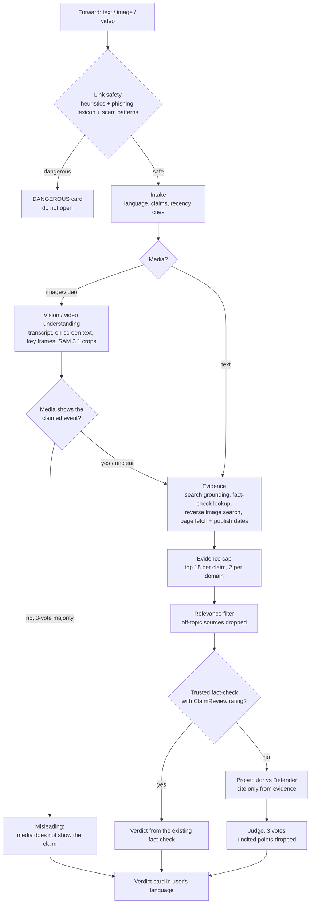

# WhatsApp Forward Court

**Demo video (2:43):** https://www.youtube.com/watch?v=er92qcF2HDM

A multi-agent fact-checker for viral WhatsApp forwards.

Forward a suspicious message, photo or video. A panel of agents puts it on trial: one argues it is true, one argues it is false, and both may cite only real, retrieved sources. A judge returns a short verdict card — **True / False / Misleading / Unverified** — in the user's language, ready to share back into the family group. Scam links and messages get **Dangerous**, or **Suspicious** when the signs are weaker.

The main target is the most common kind of misinformation in India: **real photos and videos with a false story attached** (old footage shared as today's news, a five-year-old article reshared as breaking).

> Built for the Meta Global AI Developer Hackathon 2026.

---

## Test it in 3 ways

**a) Instant replay — no key, ~10 seconds.** Recorded live traces ship with the repo. No credentials needed or included, no network, no model calls:

```bash
git clone https://github.com/anurag-devx/forward-court.git
cd forward-court
python3.11 -m venv .venv
source .venv/bin/activate
pip install -r requirements.txt
python main.py --demo --replay
```

**b) Live demo with your own Meta key (~10 minutes).** Same 7 samples, run live through the models. Only `MODEL_API_KEY` is required:

```bash
cp .env.example .env
# set MODEL_API_KEY in .env
python main.py --demo
```

**c) Your own forward:**

```bash
# text
python main.py "Breaking: massive floods hit Patna today, bridge collapsed"

# image, optional caption
python main.py --image forward.jpg --caption "This is from yesterday's rally"

# video (max 16 MB, WhatsApp's limit)
python main.py --video forward.mp4 --caption "Flood in Patna today"
```

**On Windows** (verified order on a clean machine — Command Prompt and PowerShell):

1. Install Python 3.11 from python.org, ticking **Add python.exe to PATH**. Git is optional — "Download ZIP" from GitHub works.
2. `cd` into the folder containing `main.py` (a ZIP extract lands at `forward-court-main\forward-court-main`).
3. Create the venv **before** installing anything: `py -3.11 -m venv .venv` (or `python -m venv .venv`).
4. Activate it — Command Prompt: `.venv\Scripts\activate.bat` · PowerShell: `.venv\Scripts\Activate.ps1` (if script execution is blocked: `Set-ExecutionPolicy -Scope Process -ExecutionPolicy Bypass`).
5. `pip install -r requirements.txt`
6. So the card symbols print — Command Prompt: `set PYTHONUTF8=1` · PowerShell: `$env:PYTHONUTF8="1"`
7. `python main.py --demo --replay` — then `copy .env.example .env`, set `MODEL_API_KEY` in `.env`, and `python main.py --demo` for the live run.

Requires Python 3.11 and ffmpeg. The demo set (`demo/samples.json`) is 7 samples: real + fake text, real + fake screenshots (both generated by us under a fictional masthead), real + recycled news links, and a scam message with a fictional lookalike link.

Switching replay ↔ live: `--demo --replay` reads the committed traces in `demo/recordings/`; `--demo` ignores them and runs everything live; `--demo --record` refreshes the traces. Each recording holds the input, claims with type tags, link-safety signals, evidence (URLs, outlets, tiers, dates), relevance drops, ClaimReview hits, debater points with citations, all 3 judge votes, verdict + card, model ids, per-stage tokens/times, timestamp, and git commit — scrubbed of keys, phone numbers, tunnel URLs, and media bytes.

## How it works



## What it handles

- **Text forwards** — checkable claims in English, Hindi, and more; recency cues ("breaking", "today") feed the recycled-content check.
- **Screenshots** — claims split into *content claims* (headlines, statements, visible text — checked like text) and *photo-origin claims* (where/when the photo was taken — capped at Unverified without reverse-search provenance). A visibly impersonated outlet domain (e.g. `abcnews.com.co`) is flagged as evidence.
- **News links** — the article headline becomes a claim; the outlet tier is noted. An old article shared as new is Misleading; a bare old link gets an "Article from \<date\>" line and is judged on its merits. The shared article can never be its own key source for True.
- **Dangerous links and scam messages** — checked before anything is fetched: lookalike/brand-spoof domains, risky downloads, new domains, and message scam patterns (OTP requests, fake KYC, prize traps). Verdict: Dangerous, with a "do not open" card.
- **Images and video** — vision/video understanding, transcripts, key frames, SAM crops, exact-match provenance. Supported in the CLI; not part of `--demo`.

## Verdicts

**True** — strong cited evidence confirms it. **False** — strong cited evidence refutes it. **Misleading** — real media or article, wrong context (recycled as new, or media that does not show the claim). **Unverified** — not enough evidence either way. **Dangerous** — malicious link or scam message; do not open it. **Suspicious** — some scam signs but below the Dangerous bar; the card leads with "Be careful — scam signs", lists the matched reasons, and ends with the safety line.

## Sample verdict cards

Real outputs from the demo set (`tests/samples/demo/DEMO.md`).

Text — lemon-cancer forward:

```
❌ *Forward Court Verdict: FALSE*
Confidence: high
Already fact-checked by vishvasnews.com

Already fact-checked by vishvasnews.com: rated False.

🔗 Source: https://www.vishvasnews.com/english/health/fact-check-false-claims-of-curing-cancer-getting-viral/
```

Image — Pithoragarh bridge collapse (Hindi card):

```
⚠️ *फॉरवर्ड कोर्ट निर्णय: MISLEADING*
विश्वास: high
पहले से तथ्य-जांचित: english.factcrescendo.com

वायरल वीडियो में पिथौरागढ़ में ओवरलोड ट्रक के कारण पुल ढहने की घटना वास्तव में पुरानी है, हाल की नहीं। फैक्ट-चेक के अनुसार यह 2020 का पुराना वीडियो है जिसे हाल की घटना बताकर वायरल किया जा रहा है, इसलिए इसे नया बताकर पेश करना भ्रामक है।

🔗 स्रोत: https://english.factcrescendo.com/2026/10/27/old-video-of-a-bridge-collapse-in-pithoragarh-in-uttarakhand-goes-viral-as-recent/
```

Video — Cyclone Arnab old clip:

```
⚠️ *Forward Court Verdict: MISLEADING*
Confidence: high
Already fact-checked by english.factcrescendo.com

The clip does show trees swaying amid powerful winds, but fact-checks identify it as an old video recycled as footage of Cyclone Arab/Arnab wreaking havoc in Visakhapatnam, Andhra Pradesh. The same tree-swaying clip was previously falsely linked to Cyclone Biparjoy. A severe Cyclone Arnab did make landfall on the Andhra Pradesh coast on 28 Oct 2026, but this video is not from that event.

🔗 Source: https://english.factcrescendo.com/2026/10/28/old-video-goes-viral-linking-to-cyclone-arnab-in-visakhapatnam-ap/
```

## Design rules

- **Evidence first.** Both debating agents get the same evidence list and may cite only from it.
- **Uncited points are dropped.** The judge ignores any argument without a source.
- **No invented sources.** If live search fails, the run stops — the model is never asked to produce URLs on its own.
- **Safety before fetching.** Link checks run before any contact with a linked host; a flagged host is never fetched, and flagged URLs never enter evidence.
- **Provenance-only recycling.** An image or video is called "old" only from evidence about *that exact media* (exact reverse-image matches or a fact-check tied to it), never from articles about other events.
- **Unverified when unsure.** True/False only on strong cited evidence. It never claims "deepfake" without strong grounds.
- **Existing fact-checks first.** A rating published by a trusted fact-checker (ClaimReview markup) decides the verdict unless another trusted source contradicts it.
- **Tier-3 sources never decide.** Social and user-generated sources add context but can never be the key source behind a verdict.
- **Media–caption mismatch gate.** When the photo or video provably does not show the claimed event (3-vote majority), the verdict is Misleading without a debate.
- **Stable verdicts.** The judge votes three times; ties become Unverified.

## Meta models at runtime

| Need | Tool |
|---|---|
| Agents, judge, search grounding, image + video understanding | Muse Spark 1.3 |
| Subjects in images and video frames | SAM 3.1 |
| Speech in videos and voice notes | Muse Voice Transcribe |
| Development | Muse Code |

SAM 3.1 crops feed Muse Spark zoomed views to read small text (URL bars, dates, watermarks).

Two non-model services are built but **disabled for the hackathon** per the runtime-model rule (SerpAPI Google Lens is not an allowed runtime model; Safe Browsing use could not be confirmed). They are not judging options — leave them off:

- SerpAPI reverse image search — media provenance is therefore limited; photo-origin claims stay Unverified without it.
- Google Safe Browsing — link reputation is therefore limited; link safety rests on deterministic heuristics, a phishing lexicon, and scam-pattern reading.

WhatsApp delivery via the Vonage Messages API Sandbox (Twilio sender available; Meta Cloud API sender stubbed).

## Speed & cost

Measured wall-clock per forward (model latency varies run to run):

| Path | Time | Notes |
|---|---|---|
| Scam / dangerous link | ~15s | deterministic checks + scam-pattern read short-circuit |
| Already fact-checked | ~30–60s | trusted-outlet lookup decides; grounding, debate, votes skipped |
| Full debate | ~1–2 min | lookup + grounding raced concurrently, then debate + 3 judge votes |
| Repeat forward | <1s, 0 tokens | local SQLite cache (`.cache/`, gitignored) |

Cost follows the same ladder: an early fact-check exit uses ~17k tokens vs ~40–85k for a full debate, and cache repeats use none. Cache TTLs: 24h default, 7 days for DANGEROUS / False-by-ClaimReview, 1h for Unverified; errors and timeouts are never cached. `CACHE=off` or `--no-cache` bypasses the cache.

## Run it

Check a forward — see [Test it in 3 ways](#test-it-in-3-ways) for setup and commands.

Run tests (offline, no API calls):

```bash
python -m pytest tests/ -q
```

552 tests. Bench media is collected locally with yt-dlp
(`requirements-dev.txt`, testing only); no media files are committed.

### WhatsApp gateway (optional)

```bash
python -m gateway   # uvicorn on :8000
cloudflared tunnel --url http://127.0.0.1:8000
```

Set the Twilio number's incoming-message webhook to `<tunnel-url>/webhook`
(POST). `PUBLIC_BASE_URL` must match the tunnel URL exactly, or signature
validation fails.

Vonage Messages API Sandbox instead of Twilio: allow-list your number on the
sandbox page, set `WHATSAPP_PROVIDER=vonage` plus `VONAGE_API_KEY`,
`VONAGE_API_SECRET`, `VONAGE_WHATSAPP_NUMBER`, and either
`VONAGE_SIGNATURE_SECRET` (signed webhooks) or `VONAGE_WEBHOOK_TOKEN`
(`?t=` gate) in `.env`. Point the sandbox inbound webhook at
`<tunnel-url>/webhook/vonage` and the status webhook at
`<tunnel-url>/webhook/vonage/status`. Sandbox limits: 100 msgs/month, 24h
messaging window, no templates.

## Status

- Done - Text forwards
- Done - Image forwards (vision, SAM crops, earliest-copy check; reverse search built, off)
- Done - Video forwards (video understanding, transcript, key frames, media–caption check)
- Done - Fact-check lookup, ClaimReview verdicts, relevance filter, 3-vote judge
- Done - Link safety (heuristics, phishing lexicon, scam patterns; Safe Browsing built, off) and news links
- Done - WhatsApp gateway via Twilio and Vonage sandbox
- Done - Judge demo (`python main.py --demo`, works with only MODEL_API_KEY)
- In Progress - Meta WhatsApp Cloud API sender (stubbed; developer access pending)
- Out of Scope -  Video links (YouTube/Instagram) — out of scope for now

## Limits

- Cannot detect AI-generated or synthetic media on its own; such cases return Unverified unless a fact-check exists.
- Image origin depends on reverse image search coverage, which is disabled for the hackathon — photo-origin claims stay Unverified.
- Video originals rarely exact-match in reverse search, so recycled-video verdicts usually rest on fact-checks or the mismatch gate.
- Full runs take about 1–3 minutes (text fastest, video slowest); the 7-sample demo takes about 10 minutes.
- Sources behind paywalls or heavy JavaScript may be skipped.

## What's next

- **Smarter cache.** Normalized-claim and perceptual-hash matching on top of the existing repeat cache: skip repeat work on the same viral forward by matching text on normalized claims and screenshots on perceptual hash + extracted text. Cache entries expire by verdict type (False/Dangerous persist longer than Unverified), in-flight duplicate checks are merged into one run, and only hashes, claims, and verdicts are stored — never user data.
- **"Checked N times" + trending-rumours feed.** Show how often a claim has already been checked on the card, and expose the most-checked claims as a feed for fact-checkers.

## License

MIT
