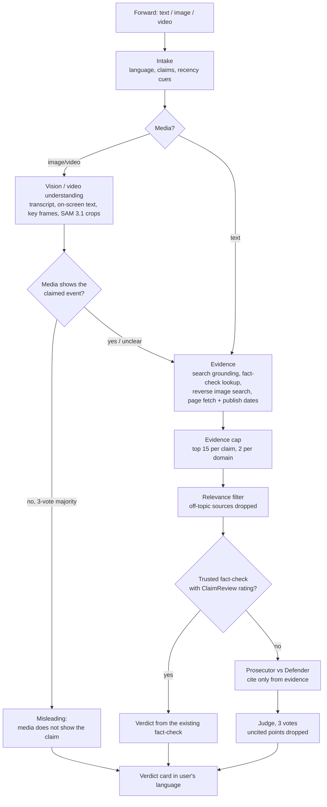

# WhatsApp Forward Court

A multi-agent fact-checker for viral WhatsApp forwards.

Forward a suspicious message, photo or video. A panel of agents puts it on trial: one argues it is true, one argues it is false, and both may cite only real, retrieved sources. A judge returns a short verdict card — **True / False / Misleading / Unverified** — in the user's language, ready to share back into the family group.

The main target is the most common kind of misinformation in India: **real photos and videos with a false story attached** (old footage shared as today's news, a five-year-old article reshared as breaking).

> Built for the Meta Global AI Developer Hackathon 2026.

---

## How it works



## Sample verdict cards

Real outputs from the demo set (`tests/samples/demo/DEMO.md`).

Text — lemon-cancer forward:

```
❌ *Forward Court Verdict: FALSE*
Confidence: high
Already fact-checked by vishvasnews.com

Already fact-checked by vishvasnews.com: rated False.

🔗 Source: https://www.vishvasnews.com/english/health/fact-check-false-claims-of-curing-cancer-getting-viral/
```

Image — Pithoragarh bridge collapse (Hindi card):

```
⚠️ *फॉरवर्ड कोर्ट निर्णय: MISLEADING*
विश्वास: high
पहले से तथ्य-जांचित: english.factcrescendo.com

वायरल वीडियो में पिथौरागढ़ में ओवरलोड ट्रक के कारण पुल ढहने की घटना वास्तव में पुरानी है, हाल की नहीं। फैक्ट-चेक के अनुसार यह 2020 का पुराना वीडियो है जिसे हाल की घटना बताकर वायरल किया जा रहा है, इसलिए इसे नया बताकर पेश करना भ्रामक है।

🔗 स्रोत: https://english.factcrescendo.com/2026/10/27/old-video-of-a-bridge-collapse-in-pithoragarh-in-uttarakhand-goes-viral-as-recent/
```

Video — Cyclone Arnab old clip:

```
⚠️ *Forward Court Verdict: MISLEADING*
Confidence: high
Already fact-checked by english.factcrescendo.com

The clip does show trees swaying amid powerful winds, but fact-checks identify it as an old video recycled as footage of Cyclone Arab/Arnab wreaking havoc in Visakhapatnam, Andhra Pradesh. The same tree-swaying clip was previously falsely linked to Cyclone Biparjoy. A severe Cyclone Arnab did make landfall on the Andhra Pradesh coast on 28 Oct 2026, but this video is not from that event.

🔗 Source: https://english.factcrescendo.com/2026/10/28/old-video-goes-viral-linking-to-cyclone-arnab-in-visakhapatnam-ap/
```

## Design rules

- **Evidence first.** Both debating agents get the same evidence list and may cite only from it.
- **Uncited points are dropped.** The judge ignores any argument without a source.
- **No invented sources.** If live search fails, the run stops — the model is never asked to produce URLs on its own.
- **Provenance-only recycling.** An image or video is called "old" only from evidence about *that exact media* (exact reverse-image matches or a fact-check tied to it), never from articles about other events.
- **Unverified when unsure.** True/False only on strong cited evidence. It never claims "deepfake" without strong grounds.
- **Existing fact-checks first.** A rating published by a trusted fact-checker (ClaimReview markup) decides the verdict unless another trusted source contradicts it.
- **Tier-3 sources never decide.** Social and user-generated sources add context but can never be the key source behind a verdict.
- **Media–caption mismatch gate.** When the photo or video provably does not show the claimed event (3-vote majority), the verdict is Misleading without a debate.
- **Stable verdicts.** The judge votes three times; ties become Unverified.

## Built with

| Need | Tool |
|---|---|
| Agents, judge, search grounding, image + video understanding | Muse Spark 1.3 |
| Subjects in images and video frames | SAM 3.1 |
| Speech in videos and voice notes | Muse Voice Transcribe |
| Development | Muse Code |
| Reverse image search | SerpAPI (Google Lens) |
| Delivery | Twilio WhatsApp API (WhatsApp Cloud API stubbed) |

## Run it

Requires Python 3.11 and ffmpeg.

```bash
git clone https://github.com/anurag-devx/forward-court.git
cd forward-court
python3.11 -m venv .venv
source .venv/bin/activate
pip install -r requirements.txt
```

Create `.env`:

```
MODEL_API_KEY=...      # Meta Model API
SERPAPI_KEY=...        # reverse image search (optional; image origin stays Unverified without it)
TWILIO_ACCOUNT_SID=...
TWILIO_AUTH_TOKEN=...
TWILIO_WHATSAPP_FROM=...
PUBLIC_BASE_URL=...        # public tunnel URL, for webhook signature validation
```

Check a forward:

```bash
# text
python main.py "Breaking: massive floods hit Patna today, bridge collapsed"

# image, optional caption
python main.py --image forward.jpg --caption "This is from yesterday's rally"

# video (max 16 MB, WhatsApp's limit)
python main.py --video forward.mp4 --caption "Flood in Patna today"
```

Run tests (offline, no API calls):

```bash
python -m pytest tests/ -q
```

305 tests. Bench media is collected locally with yt-dlp
(`requirements-dev.txt`, testing only); no media files are committed.

WhatsApp gateway:

```bash
python -m gateway   # uvicorn on :8000
cloudflared tunnel --url http://127.0.0.1:8000
```

Set the Twilio number's incoming-message webhook to `<tunnel-url>/webhook`
(POST). `PUBLIC_BASE_URL` must match the tunnel URL exactly, or signature
validation fails.

## Status

- Done - Text forwards
- Done - Image forwards (vision, SAM crops, reverse search, earliest-copy check)
- Done - Video forwards (video understanding, transcript, key frames, media–caption check)
- Done - Fact-check lookup, ClaimReview verdicts, relevance filter, 3-vote judge
- Done - WhatsApp gateway via Twilio
- In Progress - Meta WhatsApp Cloud API sender (stubbed; developer access pending)
- Out of Scope -  Video links (YouTube/Instagram) — out of scope for now

## Limitations

- Cannot detect AI-generated or synthetic media on its own; such cases return Unverified unless a fact-check exists.
- Image origin depends on reverse image search coverage.
- Video originals rarely exact-match in reverse search, so recycled-video verdicts usually rest on fact-checks or the mismatch gate.
- Full runs take about 1–3 minutes (text fastest, video slowest).
- Sources behind paywalls or heavy JavaScript may be skipped.

## License

MIT
