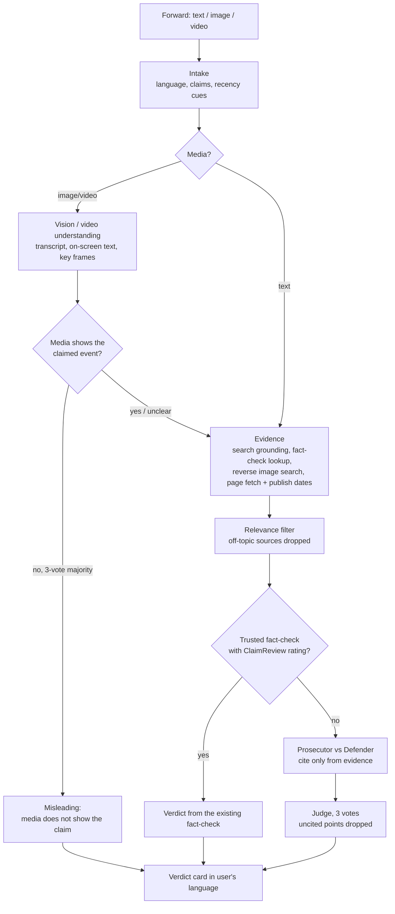

# WhatsApp Forward Court

A multi-agent fact-checker for viral WhatsApp forwards.

Forward a suspicious message, photo or video. A panel of agents puts it on trial: one argues it is true, one argues it is false, and both may cite only real, retrieved sources. A judge returns a short verdict card — **True / False / Misleading / Unverified** — in the user's language, ready to share back into the family group.

The main target is the most common kind of misinformation in India: **real photos and videos with a false story attached** (old footage shared as today's news, a five-year-old article reshared as breaking).

> Built for the Meta Global AI Developer Hackathon 2026.

---

## How it works



## Sample verdict card

```
❌ MISLEADING (high confidence)

This photo is real, but it is from 2022, not this week's floods.
The same image appeared in news reports two years before this forward.

Source: <earliest source URL>
Already fact-checked by <outlet>
```

## Design rules

- **Evidence first.** Both debating agents get the same evidence list and may cite only from it.
- **Uncited points are dropped.** The judge ignores any argument without a source.
- **No invented sources.** If live search fails, the run stops — the model is never asked to produce URLs on its own.
- **Provenance-only recycling.** An image or video is called "old" only from evidence about *that exact media* (exact reverse-image matches or a fact-check tied to it), never from articles about other events.
- **Unverified when unsure.** True/False only on strong cited evidence. It never claims "deepfake" without strong grounds.
- **Existing fact-checks first.** A rating published by a trusted fact-checker (ClaimReview markup) decides the verdict unless another trusted source contradicts it.
- **Stable verdicts.** The judge votes three times; ties become Unverified.

## Built with

| Need | Tool |
|---|---|
| Agents, judge, search grounding, image + video understanding | Muse Spark 1.3 |
| Subjects in images and video frames | SAM 3.1 |
| Speech in videos and voice notes | Muse Voice Transcribe |
| Development | Muse Code |
| Reverse image search | SerpAPI (Google Lens) |
| Delivery | WhatsApp Cloud API *(in progress)* |

## Run it

Requires Python 3.11 and ffmpeg.

```bash
git clone https://github.com/anurag-devx/forward-court.git
cd forward-court
python3.11 -m venv .venv
source .venv/bin/activate
pip install -r requirements.txt
```

Create `.env`:

```
MODEL_API_KEY=...      # Meta Model API
SERPAPI_KEY=...        # reverse image search (optional; image origin stays Unverified without it)
```

Check a forward:

```bash
# text
python main.py "Breaking: massive floods hit Patna today, bridge collapsed"

# image, optional caption
python main.py --image forward.jpg --caption "This is from yesterday's rally"

# video (max 16 MB, WhatsApp's limit)
python main.py --video forward.mp4 --caption "Flood in Patna today"
```

Run tests (offline, no API calls):

```bash
python -m pytest tests/ -q
```

## Status

- Done - Text forwards
- Done - Image forwards (vision, SAM crops, reverse search, earliest-copy check)
- Done - Video forwards (video understanding, transcript, key frames, media–caption check)
- Done - Fact-check lookup, ClaimReview verdicts, relevance filter, 3-vote judge
- In Progress -  WhatsApp gateway — next
- Out of Scope -  Video links (YouTube/Instagram) — out of scope for now

## Limitations

- Cannot detect AI-generated or synthetic media on its own; such cases return Unverified unless a fact-check exists.
- Image origin depends on reverse image search coverage.
- Sources behind paywalls or heavy JavaScript may be skipped.

## License

MIT
